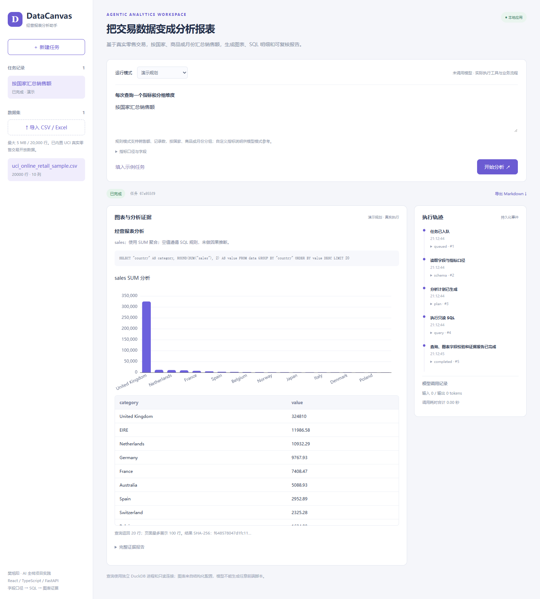

# DataCanvas 经营数据分析应用

DataCanvas 是企业数据分析与知识 Agent 项目：导入业务表和文档，通过自然语言分析数据或检索知识，查看图表、SQL、原文引用和可复核报告。应用使用 React / TypeScript、FastAPI、DuckDB、SQLGlot、Pydantic、SQLite FTS5 和 SSE。

默认数据集是 [UCI Online Retail](https://archive.ics.uci.edu/dataset/352/online%2Bretail) 的 20,000 条真实交易子集，许可为 CC BY 4.0。来源、筛选方式、字段说明和署名见 [`examples/README.md`](examples/README.md)。该数据来自英国线上礼品零售商，时间为 2010-12 至 2011-12；它不是材料行业数据。示例销售额按数量乘单价计算，币种为英镑，不含取消单、退货和成本分析。

前端已按西安天力金属复合材料股份有限公司业务场景设计，材料类别名称依据公开披露资料；首页以代码绘制的金属层状结构示意图展示材料构成，不代表公司真实厂区或具体产品截面。素材和来源见 [`docs/COMPANY_VISUALS.md`](docs/COMPANY_VISUALS.md)。



## 本地数据分析

启动后默认载入真实数据。可按国家、商品或月份查看销售额、商品数量、平均单价、订单数和不同客户数，也可用 `国家=France`、`月份=2011-11`、`商品编码=85123A` 添加筛选。结果来自导入的交易明细，展示查询 SQL、表格、图表和 Markdown 报告，并支持下载 CSV。规则模式支持一个指标及一个分组维度，不支持的问题会明确提示。

固定数据仅保留在 `tests/fixtures/`，用于确定性回归测试和基准评测；`examples/` 中的默认样本全部来自开放数据集。测试结果只说明本地固定用例和接口链路，不代表模型准确率或生产运行指标。详见[评测口径与复现命令](docs/EVALUATION.md)。

## 企业知识库 RAG

可导入 PDF、TXT、Markdown 和 CSV 文档。系统按页提取、分块、建立全文索引，通过 BM25 检索；配置独立的 embedding 接口后以 RRF 融合词法与向量候选，再按 query-term 覆盖率轻量重排。问答会把检索片段交给生成模型，并只展示模型引用的有效来源 ID。未配置模型时仍可检索原文片段，不会伪称生成回答。数据分析 Agent 也会将相关知识片段作为受信边界明确的业务上下文。

知识库 API：`POST /api/knowledge` 导入；`GET /api/knowledge` 列表；`GET /api/knowledge/search?q=...` 检索；`GET /api/knowledge/answer?q=...` 检索并回答；`DELETE /api/knowledge/{id}` 删除。单文档上限 5 MB；可配置 OCR 处理扫描版 PDF，使用 Qdrant 和兼容 Cohere Rerank 的服务扩展向量检索与重排。

对人工标注的检索用例可调用 `POST /api/evaluations/rag`，输入 query 与相关 Chunk ID，返回 Recall@k、Precision@k 和 MRR；系统不会生成或伪造期望标签。

## 完整流程

1. 导入 CSV / Excel，规范列名、推断数值字段，保存为独立 DuckDB 数据集。
2. 导入 PDF / TXT / Markdown / CSV，执行文本切分、FTS5 检索及可选向量检索。
3. 结合 Schema、指标词典及相关知识来源生成结构化计划；模型输出经 Pydantic 校验。
4. SQLGlot 校验单条 SELECT、表范围与函数；独立进程使用只读连接，限制内存、线程、时间及结果行数。
5. 模型规划失败时根据执行反馈修复，最多两次；持久化计划、事件、知识引用及证据报告。
6. React 渲染分析图表、检索引用和执行轨迹，可下载 Markdown / CSV。

图表使用受约束的结构化配置，由前端固定组件渲染，不执行模型生成的任意 JavaScript。

## 安装与运行

需要 Python 3.12+、Node.js 20+。

```powershell
python -m venv .venv
.venv\Scripts\python.exe -m pip install -r requirements.txt
cd frontend
npm.cmd ci
npm.cmd run build
cd ..
powershell -ExecutionPolicy Bypass -File .\start.ps1
```

浏览器打开 <http://127.0.0.1:8201>，API 文档为 `/docs`。规则模式不调用模型；知识库可离线做全文检索。项目使用 OpenAI-compatible 接口，已提供 DeepSeek 配置示例，也可替换为兼容服务。配置 `.env` 中的 `AI_API_KEY`、`AI_BASE_URL` 和 `AI_MODEL` 可启用生成式规划及知识问答。Embedding 是独立配置项，需提供支持 embedding 的服务密钥、地址和模型；DeepSeek 对话模型不会被误当成向量模型。

## 容器启动

安装 Docker Desktop 后，复制 `.env.example` 为 `.env` 并填写可选的模型配置，然后在项目根目录执行 `docker compose up --build -d --wait`。访问 <http://127.0.0.1:8203>；应用、Qdrant 和数据目录分别运行在容器与持久卷中。可通过 `DATACANVAS_PORT` 修改宿主机端口。模型和 Embedding 不配置时仍可用内置数据执行规则分析，知识库使用本地全文检索。

完整架构、运行方式、实测结果和验收证据见[项目交付报告](docs/PROJECT_REPORT.md)。

任务请求由结构化规划器生成，再经参数校验的只读 SQL 工具执行。`skills/` 下的 `SKILL.md` 可增加可版本控制的业务规范，运行时按关键词匹配并写入任务轨迹。MCP Server 可单独通过 `python -m app.mcp_server` 以 stdio 启动，或配置 `MCP_TRANSPORT=streamable-http` 使用 HTTP。出站 MCP 服务可通过 `MCP_SERVERS` 配置；`GET /api/mcp/servers/{name}/tools` 发现工具，`POST /api/mcp/servers/{name}/tools/{tool}` 只允许显式声明只读的工具。远程服务必须走 HTTPS，可选 bearer token 放在本地环境变量中；共享部署时，每个服务都要声明允许访问的 `tenant_ids`。

本地默认单用户模式。部署共享实例时，将 `DATACANVAS_AUTH_REQUIRED=true` 并为 `DATACANVAS_TOKENS` 配置随机 bearer token 到角色和租户的映射；任务、数据集、知识文档和审计记录均按租户隔离。Token 配置只放在未跟踪的 `.env` 或密钥管理服务中。单实例部署可直接使用内置身份校验；组织级身份联邦可接入 OIDC/SSO，并通过 TLS 入口和集中密钥管理统一治理。

首次启动会将开放数据样本导入本地数据库；已有数据不会被删除。CSV / Excel 上传上限为 5 MB、20,000 行。无需联网即可运行已内置的样本。

## 测试

```powershell
.venv\Scripts\python.exe -m pytest tests -q
```

项目提供可选的单实例 bearer 身份校验和租户过滤，默认保持本地单用户模式。API 密钥、本地数据库和依赖目录不提交 Git。生产身份联邦、TLS、备份/HA 与分布式任务队列尚需企业环境配置。模型输出经过结构化校验，业务口径仍需结合数据来源核对。

实现说明见[本地使用与工程说明](docs/USAGE.md)，项目摘要见[项目描述](docs/简历项目描述.md)。

企业能力范围与建设状态见[能力清单](docs/ENTERPRISE_CAPABILITIES.md)。

面向 AI Agent 工程师岗位的职责映射、演示顺序和能力边界见[岗位能力对照](docs/ROLE_ALIGNMENT.md)。

## 设计参考

应用独立实现，没有 fork 或复制参考项目的业务代码。参考产品方向与官方资料：

- [DataFoundry](https://github.com/datagallery-ai/dataagent)：可治理数据分析任务与证据追溯。
- [Tencent BrowserSkill](https://github.com/Tencent/BrowserSkill)：浏览器业务自动化方向。
- [Chrome WebMCP](https://developer.chrome.com/docs/ai/webmcp)：浏览器页面工具接口参考。

基础依赖的许可由对应项目维护；独立应用使用 MIT 许可。

