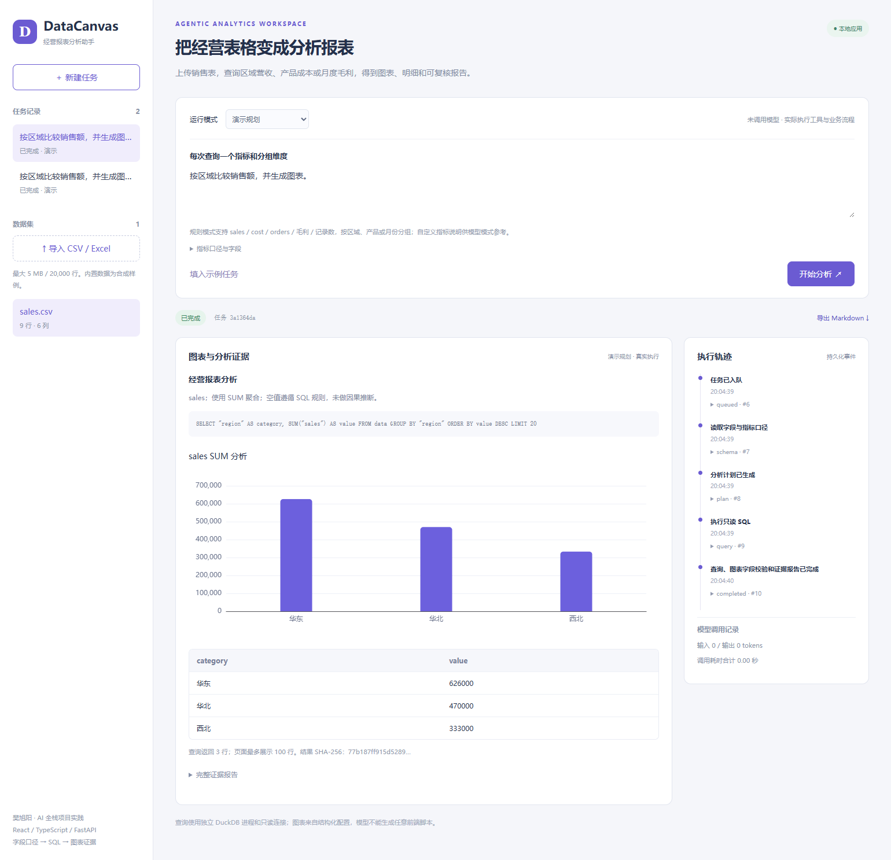

# DataCanvas 经营报表分析 Agent

个人独立设计与搭建的 AI 全栈应用：上传 CSV / Excel，描述分析目标，执行结构化规划与只读 SQL，生成图表、表格及证据报告。应用业务代码从空目录实现，使用 React / TypeScript、FastAPI、DuckDB、SQLGlot、Pydantic、SQLite 和 SSE。




## 本地评测与业务示例

面向经营分析人员：输入销售表和‘按区域比较销售额’，得到华东 626000、华北 470000、西北 333000 的柱状图、SQL 明细和 Markdown 报告。也支持按月统计毛利（sales − cost）、按产品统计成本。每次规则查询使用一个指标和一个维度，复杂多指标问题会提示拆分。

查询数值与独立 Python 汇总结果一致：100/100。本地完整流程 10/10 通过。样本均为固定合成数据，当前没有调用模型，不能称为大模型准确率。详见 [评测口径、逐项结果与复现命令](docs/EVALUATION.md)。

## 完整流程

1. 上传表格，规范列名、推断数值字段，形成独立 DuckDB 数据集。
2. 结合字段 Schema 与用户填写的指标词典，生成经过 Pydantic 校验的 SQL 和 ChartSpec。
3. SQLGlot 校验单条 SELECT、表范围与函数。独立进程使用只读连接，关闭外部访问和扩展自动加载，并限制内存、线程、时间及返回行数。
4. 真实模式遇到 SQL / 图表字段错误时，将执行反馈送回规划器，最多修复两次。
5. React 根据结构化图表配置渲染 ECharts；持久化计划、SQL、结果校验值与报告，可下载 Markdown。

这类 Generative UI 的边界是“模型选择受约束图表结构，前端决定如何渲染”，没有运行模型生成的任意 JavaScript。

## 安装与运行

需要 Python 3.12+、Node.js 20+。

```powershell
python -m venv .venv
.venv\Scripts\python.exe -m pip install -r requirements.txt
cd frontend
npm.cmd ci
npm.cmd run build
cd ..
powershell -ExecutionPolicy Bypass -File .\start.ps1

```

浏览器打开 <http://127.0.0.1:8201>，API 文档为 `/docs`。默认演示模式不调用模型，但数据库、工具和页面实际执行。真实模型模式需要将 `.env.example` 复制为 `.env` 并配置兼容接口。没有验证真实供应商端到端成功率，模型修复测试使用可控模拟响应。

## 测试

```powershell
.venv\Scripts\python.exe -m pytest tests -q
```

应用仅供本地单用户作品展示，没有生产鉴权；示例数据与门户均为合成内容。密钥、数据库、依赖目录不提交 Git。模型返回内容一律经过结构化校验，仍需用户核对业务含义。

实现与面试讨论见 [工程说明](docs/INTERVIEW.md)。

## 设计参考

应用独立实现，没有 fork 或复制参考项目的业务代码。参考产品方向与官方资料：

- [DataFoundry](https://github.com/datagallery-ai/dataagent)（GitHub 创建于 2026-06-18）：可治理数据分析任务与证据追溯。
- [Tencent BrowserSkill](https://github.com/Tencent/BrowserSkill)（GitHub 创建于 2026-06-22）：浏览器业务自动化方向。
- [Chrome WebMCP](https://developer.chrome.com/docs/ai/webmcp)：页面工具的实验性浏览器接口。

基础依赖的许可仍由对应项目维护；独立应用使用 MIT 许可。
