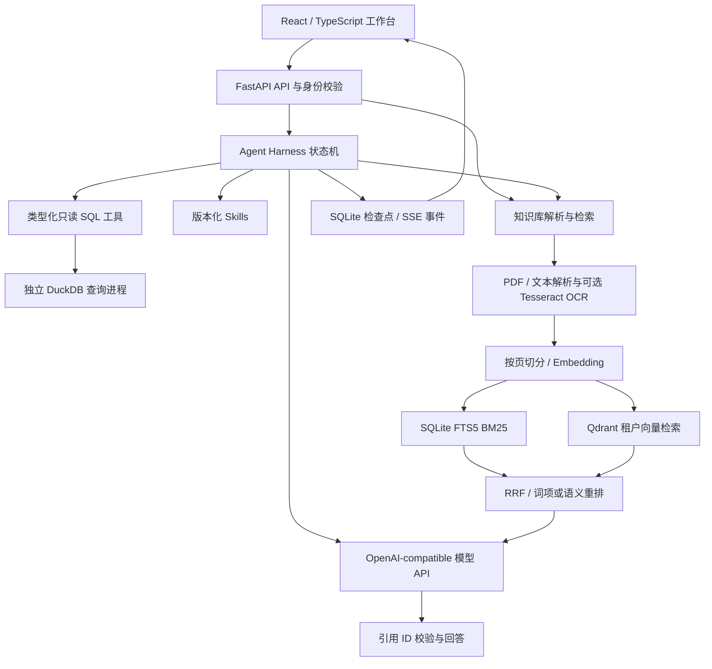

# 天力复材材料数据智能平台：完整项目报告

报告日期：2026-11-04（用户时区：Asia/Shanghai）。

## 1. 交付与验收结论

本项目提供材料行业知识检索、自然语言数据分析、结构化 Agent 执行、结果校验与报告导出。Windows 原生应用和 Docker 应用均已在本机启动；Docker 应用与 Qdrant 均达到 healthy 状态。

本轮实际执行了后端自动化、离线规则数值回归、HTTP 工程流程、容器真实模型与向量库验收、扫描 PDF OCR、桌面与手机浏览器验证、容器重启持久化验证。已执行用例均通过，所覆盖的演示流程未发现阻断性问题。这表示本轮场景可复现，不等同于对所有输入、外部服务和生产负载作无故障保证。

| 验收层次 | 本轮结果 | 证据 |
| --- | --- | --- |
| 后端单元与 API 用例 | 40/40 通过；13.36 秒 | `verification/summary.json` |
| Ruff 静态检查 | 通过，使用 CI 的 F 规则集 | 同上 |
| 前端生产构建 | TypeScript 校验和 Vite 构建通过；Docker 构建实际包含前端产物 | Dockerfile / 本轮构建输出 |
| 离线 SQL 数值回归 | 当前规则规划器 100/100；越界负例拒绝 6/6 | `verification/sql-results.json` |
| HTTP 工程流程 | 10/10 流程、40/40 断言；p50 961.41 ms，p95 1095.97 ms | `verification/engineering-results.json` |
| 容器端到端 | 23/23 通过，含真实 DeepSeek 调用、真实 Qdrant 服务与真实 OCR 引擎 | `verification/container-acceptance.json` |
| 浏览器 | 分析、SQL、结果表、事件轨迹、CSV 下载、知识导航均通过；JS 异常 0；390 px 宽度无横向溢出 | `verification/browser.json` |
| 容器重启 | 重启前后任务均为 7 条，已完成任务报告仍返回 HTTP 200 | `verification/restart.json` |
| 依赖一致性 | 项目独立 `.venv` 安装完成，`pip check` 通过 | 本机环境 |

## 2. 业务定位与数据口径

平台围绕西安天力金属复合材料股份有限公司的材料知识与数据使用场景组织前端。产品系列文字参考公开披露资料，具体来源见 `COMPANY_VISUALS.md`。页面的层状金属结构由 SVG 代码绘制；验收截图是浏览器真实渲染，不使用 AI 生成图片。

应用中的经营分析默认数据为 UCI Online Retail 的 20,000 条真实交易样本，许可 CC BY 4.0。它来自英国线上零售业务，不能作为天力的实际经营数据、材料订单、客户名单或生产指标。来源、字段与样本筛选方式见 `../examples/README.md`。导入授权业务 CSV/XLSX 后可以对相应文件分析。

材料产品卡片将问题带入知识库检索框；回答依据已导入的企业产品、工艺或制度资料。系统不会把卡片文字自动变成企业经营事实。

## 3. 系统架构



| 模块 | 实现位置 | 主要职责 |
| --- | --- | --- |
| 前端 | `frontend/src/App.tsx`、`style.css` | 数据导入、分析、图表、知识问答、质量概览、轨迹、导出及响应式界面 |
| API / 身份 / 生命周期 | `shared/api.py`、`app/main.py` | 请求校验、角色与租户、任务创建/取消/恢复、SSE、报告与审计 |
| Agent | `app/agent.py`、`app/tools.py` | 检索、规划、参数校验、SQL 调用、结果校验、受控修复、证据报告 |
| 知识库 | `app/knowledge.py` | 解析/OCR、分块、去重、检索融合、生成与引用约束 |
| 向量库 | `app/vector_store.py` | Qdrant 集合创建、写入、租户过滤召回与删除 |
| 重排 | `app/reranker.py` | 兼容 Cohere Rerank 格式的可选服务；异常时使用内置排序 |
| 模型 | `shared/model.py` | Chat Completions / Embeddings、结构化输出和用量记录 |
| 数据与质量 | `app/data.py`、`data_quality.py` | 导入、schema、只读 SQL AST 检查、来源摘要与质量剖析 |
| 持久化 | `shared/store.py` | 状态、检查点、事件、审计、租户数据 |
| MCP / Skills | `app/mcp_*`、`app/skills.py`、`skills/` | 工具发现、只读外部工具调用与业务技能规范 |
| 部署 / CI | `Dockerfile`、`docker-compose.yml`、`.github/workflows/checks.yml` | 前端多阶段构建、应用与 Qdrant 持久卷、健康检查及自动验证 |

## 4. 关键实现与本轮修复

**检索与生成。** 按文档页码切分，保存文件 SHA-256 和片段来源；关键词采用 FTS5 BM25，向量采用本地余弦检索或 Qdrant；通过 RRF 融合与重排选取证据。生成回答只接受来自实际证据的引用 ID；没有有效引用时不展示那段模型回答。引用有效并不能自动证明回答中的每个命题均正确，业务人员仍可通过原文核对。

**向量库一致性。** 集合名按模型与维度生成，检索带租户和模型过滤，读取原文时再次经过本地租户条件校验。文档删除同步清理向量。向量写入失败时回滚本地文档、片段和全文索引，避免接口报错后重试却留下不可重建的重复文档。

**工具与运行约束。** 工具参数采用 Pydantic 校验，SQL 经 SQLGlot 限制为受约束的只读查询，DuckDB 在独立进程内执行并限制资源与结果规模。任务状态和轨迹持久化，可取消、恢复和导出。模型输出和知识片段不会作为任意代码执行。

**本轮实际修复。** 容器监听地址从只接受容器内部回环修正为 `0.0.0.0`，原生启动仍默认 `127.0.0.1`；容器传递身份配置与 Qdrant 密钥配置；修正审批回执事件错误引用 `request.digest` 的问题；增加“无有效引用则不展示生成答案”校验；启动验收等待健康状态，避免启动瞬间误报连接失败。

**本机并行展示。** Windows 原生应用使用 8201，Docker 默认使用 8203，避免端口争用。容器和原生应用的数据存储独立；容器使用命名数据卷，不会覆盖 Windows 的 `data/`。

## 5. 本轮测试的真实覆盖范围

1. **真实模型调用**：在容器中以 DeepSeek 完成自然语言 SQL 规划和知识问答。SQL 结果与 UCI 文件按 Decimal 独立汇总的结果核对；知识问答返回有效片段引用；任务保存 token 用量记录。
2. **真实向量服务**：向实际 Qdrant 容器写入两组受控三维向量，分别属于不同测试租户。验证相似度召回、跨租户排除和删除。受控向量仅是接口验收夹具，不能当作真实 Embedding 模型的语义检索效果评测。
3. **真实 OCR**：Pillow 创建带英文验收文字的图像，嵌入无文本层 PDF；实际调用 Tesseract，验证输出含预期单词。该用例不代表复杂表格、低清中文扫描件的 OCR 准确率。
4. **语义重排**：自动化用例校验 HTTP 请求契约、鉴权、候选索引映射和关闭配置时的行为；本轮没有连接单独的在线 Cross-Encoder 提供商，不能宣称其模型重排效果已实测。
5. **离线评测**：100 条固定用例走规则规划器，使用测试夹具和真实 DuckDB。100/100 是固定 SQL 功能回归，不是 LLM 准确率。工程流程中的毫秒耗时也不能当作线上大模型响应时间。
6. **浏览器与恢复**：使用本机 Chrome 实际点击、等待完成、核对结果、下载 CSV，保存桌面与手机截图；另实际重启应用容器并核对任务与报告持久化。

当前已配置 DeepSeek 对话模型；没有配置独立的 Embedding 提供商及在线重排服务。对话模型问答使用已检索到的真实文本证据；向量数据库验收独立验证了真实服务。只有配置相应服务并补充业务标注集后，才应报告真实语义检索的 Recall/MRR 或重排增益。

## 6. 启动与展示步骤

### Windows 原生应用

项目根目录执行：

```powershell
powershell -ExecutionPolicy Bypass -File .\start.ps1 -Port 8201
```

本机 `.venv` 与前端依赖、生产构建均已准备。访问 <http://127.0.0.1:8201/>。新机器需先按 README 安装依赖并构建前端。

### Docker 应用

```powershell
docker compose up --build -d --wait
docker compose ps
```

访问 <http://127.0.0.1:8203/>。Qdrant 只在 Compose 网络内开放，不额外暴露到宿主机。OCR 引擎与中英文语言包包含在镜像中。可用 `DATACANVAS_PORT` 修改宿主机端口。

### 五分钟展示流程

1. 展示材料业务入口与当前数据来源，说明样本口径。
2. 输入“按月份查看销售额趋势”，展示图表、实际 SQL、表格、事件轨迹并下载 CSV。
3. 切换大模型规划，输入“按国家汇总销售额，前100组”，展示模型调用与结果。
4. 导入允许使用的产品资料或 PDF，提问并打开来源引用；资料中没有答案时查阅原文或调整问题。
5. 展示质量与血缘、Markdown 报告、任务历史。需要演示重启时先等待任务完成，再重启容器并重新打开报告。

规则模式默认返回前 20 个分组，可以用“前100组”请求更多组；对总量做完整核对时应明确结果范围。

## 7. 可复现验收命令

```powershell
.venv\Scripts\python.exe -m pytest tests -q
.venv\Scripts\python.exe -m ruff check app shared tests benchmarks --select F
.venv\Scripts\python.exe benchmarks/evaluate.py
.venv\Scripts\python.exe benchmarks/engineering.py
docker compose cp benchmarks/acceptance.py app:/tmp/acceptance.py
docker compose exec -T app python /tmp/acceptance.py --live
docker compose cp app:/tmp/container-acceptance.json docs/verification/container-acceptance.json
.venv\Scripts\python.exe benchmarks/browser_acceptance.py
.venv\Scripts\python.exe benchmarks/restart_acceptance.py
```

`--live` 会调用已配置的真实模型 API 并产生实际用量。浏览器脚本当前使用 Windows 标准 Chrome 路径；换机时需按实际浏览器位置修改。OCR 验收运行在容器内；原生 Windows 使用 OCR 时需要安装 Tesseract 并配置路径和语言包。

## 8. 运行维护与资料

应用上传上限为单文件 5 MB、表格 20,000 行；知识 PDF 最多解析前 200 页，提取文本最多 200,000 字符，单文档最多 1,000 个块。当前单实例后台分析任务上限为 2。测试未覆盖大规模并发、集群故障、全部恶意输入或长期稳定性，不应将本轮本机结果称为分布式生产负载证明。

用 `docker compose logs --tail 100 app` 查看运行日志，`docker compose restart app` 重启应用；普通 `down` 保留命名卷，不要在需要保留数据时使用 `down -v`。企业共享使用应根据 `.env.example` 开启角色与租户访问控制，并由部署环境管理网络入口和密钥。

密钥仅在被 Git 忽略的 `.env` 或环境变量中配置。报告、截图与 JSON 证据不包含明文密钥。源码、CI、证据和运行命令可共同用于技术复核；个人履历与团队管理经历应按真实经历陈述。

实测截图：[桌面版](verification/desktop.png) · [手机版](verification/mobile.png)。验收数据见同目录 `verification/`。
